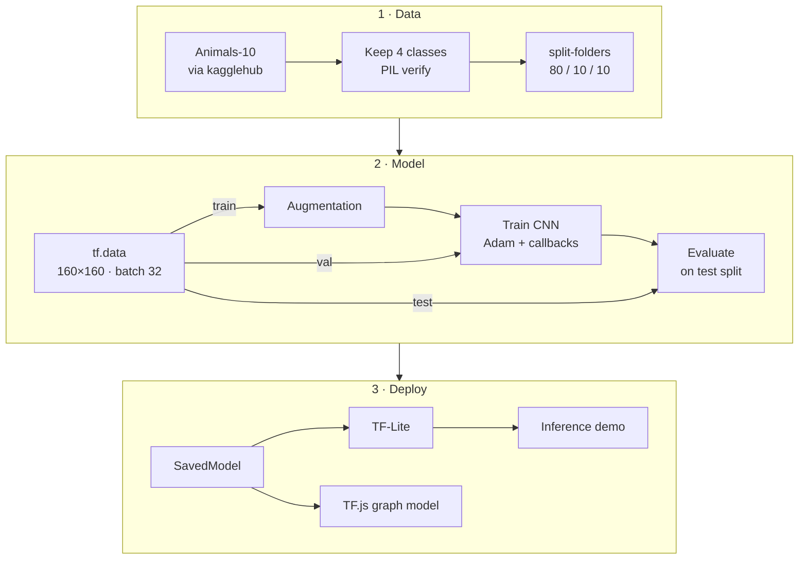

# 🐾 Animal Image Classifier: 4-Class CNN with TensorFlow & Keras 3

**A from-scratch convolutional neural network that recognises dogs, chickens, butterflies, and spiders, trained on the Animals-10 dataset and exported for Python, mobile/edge, and browser inference.**


> [!NOTE]
> Code identifiers, comments, console messages, and class labels are written in **Indonesian**. A short [glossary](#-glossary) translates the terms you will meet most often.

---

## 🧭 Contents

- [🐾 Animal Image Classifier: 4-Class CNN with TensorFlow \& Keras 3](#-animal-image-classifier-4-class-cnn-with-tensorflow--keras-3)
  - [🧭 Contents](#-contents)
  - [📖 Overview](#-overview)
  - [✨ Key Features](#-key-features)
  - [🔄 Pipeline](#-pipeline)
  - [🧠 Model Architecture](#-model-architecture)
  - [🧰 Technology Stack](#-technology-stack)
  - [🚀 Getting Started](#-getting-started)
    - [Prerequisites](#prerequisites)
    - [Option A: Run on Google Colab (shortest path)](#option-a-run-on-google-colab-shortest-path)
    - [Option B: Run locally](#option-b-run-locally)
    - [Kaggle authentication (only if prompted)](#kaggle-authentication-only-if-prompted)
  - [💡 Usage](#-usage)
    - [1. Reproduce training and exports](#1-reproduce-training-and-exports)
    - [2. Run inference with the shipped models](#2-run-inference-with-the-shipped-models)
    - [3. Interpret the output](#3-interpret-the-output)
  - [📂 Project Structure](#-project-structure)
  - [🔩 Configuration](#-configuration)
  - [🔬 Data and Methodology](#-data-and-methodology)
  - [🧪 Development and Testing](#-development-and-testing)
  - [🔧 Troubleshooting and Limitations](#-troubleshooting-and-limitations)
  - [📘 Glossary](#-glossary)
  - [📄 License and Credits](#license-and-credits)

---

## 📖 Overview

This project trains a compact convolutional neural network (CNN) **from scratch** to classify photographs into four animal classes, using a subset of the public **Animals-10** dataset. A single script, [`Classification_1.py`](Classification_1.py), implements the full lifecycle: dataset download and integrity screening, per-class train/validation/test splitting, augmentation, training with adaptive callbacks, evaluation, export to three deployment formats, and a TF-Lite inference demo. The trained model is included in all three formats.

| Output index | Label (`tflite/label.txt`) | English | Animals-10 source folder |
|:---:|---|---|---|
| 0 | `anjing` | dog | `cane` |
| 1 | `ayam` | chicken | `gallina` |
| 2 | `kupu_kupu` | butterfly | `farfalla` |
| 3 | `laba_laba` | spider | `ragno` |

**Who it serves**

- **Learners and reviewers** of an applied deep-learning exercise. The script encodes explicit acceptance thresholds: train and test accuracy of at least **85 %** (mandatory) and **95 %** (recommended).
- **Developers** who need a lightweight animal classifier (about 0.65 M parameters) for Python services, mobile/edge apps (TF-Lite), or web pages (TensorFlow.js).

**What kind of project this is.** A research/learning project made of a training pipeline and the trained model files it produces. It is not an installable library, CLI, or web service, and it has no automated test suite.

> [!IMPORTANT]
> The archive contains **no training logs, notebook outputs, or saved figures**, so this README reports no accuracy figures. Run the pipeline to reproduce them (see [Getting Started](#-getting-started)).

---

## ✨ Key Features

- **Single-file, end-to-end pipeline.** Data → model → exports → inference, organised as notebook cells (`# %%` markers).
- **Automated data acquisition.** Downloads Animals-10 with `kagglehub` and locates the `raw-img` class folders automatically.
- **Integrity screening.** Applies an extension whitelist and `PIL.Image.verify()`, then counts copied versus skipped files.
- **Dataset quality gates.** `assert` statements require ≥ 10,000 images, ≥ 3 classes, and more than one source resolution.
- **Leakage-safe preprocessing.** The split is written to disk before augmentation. Augmentation runs on the training stream only, and validation/test sets are cached unaugmented.
- **Compact custom CNN.** Four convolutional stages with BatchNorm and progressive dropout, plus a global-average-pooling head: **652,836 parameters** in total.
- **Adaptive training control.** `EarlyStopping`, `ReduceLROnPlateau`, `ModelCheckpoint`, and a custom `StopPada95` callback that stops once train **and** validation accuracy both reach 95 %.
- **Diagnostic evaluation.** Accuracy/loss curves, a test-set confusion matrix, a per-class `classification_report`, and an automatic threshold verdict.
- **Three deployment formats.** A TensorFlow SavedModel (`model.export()`), TF-Lite with `Optimize.DEFAULT` (INT8 weights, float32 input/output), and a TensorFlow.js graph model in a single weight shard.
- **Export verification.** `verifikasi_struktur()` raises an error if any required export file is missing.
- **Visual inference check.** Runs TF-Lite predictions on 8 test images and titles each one in green (correct) or red (wrong).

---

## 🔄 Pipeline



The script follows these sections, named as they appear in the file:

| Script section | What happens |
|---|---|
| *Import Semua Library* | Installs `split-folders`, imports libraries, seeds Python/NumPy/TensorFlow with `42`, and prints TF/Keras versions and GPU availability. |
| *Data Preparation* | Downloads Animals-10, copies the 4 selected classes into `WORK_DIR` with validation, reports the class distribution and resolutions, runs the quality asserts, and plots the distribution plus a sample grid. |
| *Data Preprocessing → Split Dataset* | Splits 80/10/10, builds `tf.data` datasets, and attaches augmentation to the training stream. |
| *Modelling* | Defines and compiles the CNN, then trains it for up to 50 epochs with callbacks. |
| *Evaluation and Visualization* | Computes train/test accuracy and the threshold verdict, then plots curves, the confusion matrix, and the classification report. |
| *Model Conversion* | Mounts Google Drive and exports SavedModel → TF-Lite (+ `label.txt`) → TF.js, then verifies the files. |
| *Inference* | Runs TF-Lite predictions on one shuffled batch from the test split. |
| *Save requirements.txt* | Runs `pip freeze > requirements.txt` and converts `Notebook_DL.ipynb` to Markdown. |

---

## 🧠 Model Architecture

Sequential model `cnn_klasifikasi_hewan`. All convolutions use 3×3 kernels, `padding="same"`, and ReLU. Each `MaxPooling2D` halves the spatial resolution.

| Stage | Layers | Output shape | Parameters |
|---|---|---|---:|
| Input | `Input(160, 160, 3)` → `Rescaling(1/255)` | 160 × 160 × 3 | 0 |
| Block 1 | 2 × [Conv2D 32 + BatchNorm] → MaxPool → Dropout 0.25 | 80 × 80 × 32 | 10,400 |
| Block 2 | 2 × [Conv2D 64 + BatchNorm] → MaxPool → Dropout 0.25 | 40 × 40 × 64 | 55,936 |
| Block 3 | 2 × [Conv2D 128 + BatchNorm] → MaxPool → Dropout 0.30 | 20 × 20 × 128 | 222,464 |
| Block 4 | Conv2D 256 + BatchNorm → MaxPool → Dropout 0.30 | 10 × 10 × 256 | 296,192 |
| Head | GlobalAveragePooling2D → Dense 256 (ReLU) + BatchNorm → Dropout 0.50 | 256 | 66,816 |
| Output | Dense 4 (softmax) | 4 | 1,028 |
| **Total** | | | **652,836** |

Of these, 650,916 parameters are trainable and 1,920 are non-trainable (BatchNorm moving statistics).

- **Compile settings:** `Adam(learning_rate=1e-3)`, `sparse_categorical_crossentropy`, metric `accuracy`.
- **Design rationale:** GlobalAveragePooling replaces a dense `Flatten` head, which keeps the parameter count small. BatchNorm after every convolution stabilises optimisation, and dropout rises with depth (0.25 → 0.50) to counter overfitting.

> Parameter counts are derived from the layer definitions in `Classification_1.py`; no `model.summary()` output is included in the archive. The kernel shapes in `tfjs_model/model.json` (for example `[3, 3, 3, 32]` … `[3, 3, 128, 256]`, `[256, 256]`, `[256, 4]`) match this architecture.

---

## 🧰 Technology Stack

Versions come from `requirements.txt` unless noted otherwise.

| Technology | Version | Role in this project |
|---|---|---|
| Python | 3.12 *(inferred from `cp312` wheel tags in `requirements.txt`)* | Runtime |
| TensorFlow | 2.20.0 | `tf.data` input pipeline, training backend, SavedModel and TF-Lite conversion |
| Keras | 3.13.2 | Model definition, augmentation layers, callbacks, `model.export()` |
| kagglehub | 1.0.2 | Dataset download (`alessiocorrado99/animals10`) |
| split-folders | *not pinned; installed by the script* | Per-class 80/10/10 train/val/test split on disk |
| Pillow | 11.3.0 | Image verification and resolution scanning |
| NumPy | 2.0.2 | Array handling and `argmax` decoding |
| scikit-learn | 1.6.1 | `confusion_matrix` and `classification_report` |
| Matplotlib | 3.10.0 | Distribution, sample, training-curve, confusion-matrix, and prediction plots |
| pandas | 2.2.2 | Imported but not used by the current code |
| TensorFlow.js converter | 4.22.0 *(recorded in `tfjs_model/model.json`; installed unpinned by the script)* | SavedModel → TF.js graph model |
| tf_keras | 2.20.0 | Legacy Keras needed by the TF.js converter (`TF_USE_LEGACY_KERAS=1`) |
| Google Colab | — | Target runtime: `/content` paths, Drive mount, `!` shell magics |

---

## 🚀 Getting Started

### Prerequisites

- A **Google Colab** runtime (the code targets it directly). A GPU runtime is optional but recommended; training on CPU is substantially slower.
- A **Google account** for the Drive mount used in the export step.
- **Kaggle access** only if `kagglehub` asks for it. Public resources usually download without authentication.

### Option A: Run on Google Colab (shortest path)

1. Convert the percent-format script to a notebook:

   ```bash
   pip install jupytext
   jupytext --to notebook Classification_1.py   # writes Classification_1.ipynb
   ```

2. In Colab, choose **File → Upload notebook** and select `Classification_1.ipynb`.
3. Optional: **Runtime → Change runtime type → GPU**.
4. Choose **Runtime → Run all**. When the *Konversi Model* cell runs, approve the Google Drive access prompt.
5. Collect the exports from `/content/drive/MyDrive/submission/` (`saved_model/`, `tflite/`, `tfjs_model/`).

### Option B: Run locally

`requirements.txt` is a full Colab `pip freeze` and will not install as-is outside Colab (see [Troubleshooting](#-troubleshooting-and-limitations)). Install the project-relevant pins instead:

```bash
python3.12 -m venv .venv
source .venv/bin/activate              # Windows: .venv\Scripts\activate

pip install tensorflow==2.20.0 keras==3.13.2 kagglehub==1.0.2 numpy==2.0.2 \
            pandas==2.2.2 matplotlib==3.10.0 pillow==11.3.0 scikit-learn==1.6.1 \
            split-folders jupyter jupytext

# Optional: only needed for the TF.js export step
pip install tensorflowjs==4.22.0 tf_keras==2.20.0
```

Installing `tensorflowjs` and `tf_keras` beforehand makes the script's `pastikan_dependensi()` skip its own unpinned install. Next, adapt the Colab-specific lines:

| Colab-specific code | Where | Local replacement |
|---|---|---|
| `!pip install split-folders --quiet` | first cell | Remove (already installed above) |
| `WORK_DIR = "/content/dataset_kerja"` | *Data Preparation* | A local path, e.g. `"./data/dataset_kerja"` |
| `OUTPUT_SPLIT = "/content/dataset_split"` | *Split Dataset* | e.g. `"./data/dataset_split"` |
| `ModelCheckpoint("/content/model_terbaik.keras", ...)` | *Modelling* | e.g. `"./model_terbaik.keras"` |
| `from google.colab import drive` / `drive.mount(...)` | *Konversi Model* | Remove both lines |
| `SUBMISSION_DIR = "/content/drive/MyDrive/submission"` | *Konversi Model* | e.g. `"./submission"` |
| `!pip freeze ...`, `!jupyter nbconvert ...` | last cells | Remove, or run in a shell |

Then open the notebook and run all cells:

```bash
jupytext --to notebook Classification_1.py
jupyter notebook Classification_1.ipynb
```

### Kaggle authentication (only if prompted)

`kagglehub` accepts an API token through `kagglehub.login()`, the `KAGGLE_API_TOKEN` environment variable, `~/.kaggle/access_token`, or a Colab secret named `KAGGLE_API_TOKEN`. A legacy `~/.kaggle/kaggle.json` also works.

```bash
export KAGGLE_API_TOKEN="<your-kaggle-api-token>"   # placeholder; never commit real tokens
```

---

## 💡 Usage

### 1. Reproduce training and exports

Run the notebook top to bottom ([Getting Started](#-getting-started)). Cells depend on earlier ones (for example, the *Inference* cell uses `TFLITE_DIR` from *Konversi Model*), so run them in order. A run produces:

- **Console:** class distribution, number of unique resolutions, the label order `['anjing', 'ayam', 'kupu_kupu', 'laba_laba']`, `model.summary()`, per-epoch logs, train/test accuracy with a threshold verdict, the classification report, and a listing of the export directory.
- **Figures** (shown inline, not saved): class-distribution bar chart, 4 sample images per class, accuracy/loss curves, test-set confusion matrix, and the 8-image TF-Lite prediction grid.
- **Files:** the three export folders under `SUBMISSION_DIR`, plus the best checkpoint `model_terbaik.keras`.

### 2. Run inference with the shipped models

> [!IMPORTANT]
> **Input contract (all formats):** RGB, float32, shape `[batch, 160, 160, 3]`, with **raw pixel values in 0–255**. `Rescaling(1/255)` is built into the model, so **do not normalise inputs yourself**. Resize bilinearly, as `image_dataset_from_directory` does during training. The output is a `[batch, 4]` softmax vector in `tflite/label.txt` order.

<details open>
<summary><strong>TF-Lite (Python)</strong> — mirrors the script's <code>prediksi_tflite()</code></summary>

```python
import numpy as np
from PIL import Image

try:
    from ai_edge_litert.interpreter import Interpreter   # LiteRT, successor to tf.lite
except ImportError:
    import tensorflow as tf
    Interpreter = tf.lite.Interpreter

labels = [l.strip() for l in open("tflite/label.txt", encoding="utf-8") if l.strip()]

interpreter = Interpreter(model_path="tflite/model.tflite")
interpreter.allocate_tensors()
inp = interpreter.get_input_details()[0]
out = interpreter.get_output_details()[0]

img = Image.open("path/to/your_image.jpg").convert("RGB")
img = img.resize((160, 160), Image.Resampling.BILINEAR)
x = np.asarray(img, dtype=np.float32)[np.newaxis, ...]   # (1, 160, 160, 3), values 0–255

interpreter.set_tensor(inp["index"], x)
interpreter.invoke()
probs = interpreter.get_tensor(out["index"])[0]

top = int(np.argmax(probs))
print(f"{labels[top]} ({probs[top]:.1%})")
```

</details>

<details>
<summary><strong>SavedModel (Python / TensorFlow)</strong></summary>

```python
import numpy as np
import tensorflow as tf

labels = [l.strip() for l in open("tflite/label.txt", encoding="utf-8") if l.strip()]
model = tf.saved_model.load("saved_model")             # artifact created by model.export()

img = tf.keras.utils.load_img("path/to/your_image.jpg",
                              target_size=(160, 160), interpolation="bilinear")
x = tf.keras.utils.img_to_array(img)[np.newaxis, ...]   # float32, values 0–255

probs = model.serve(tf.constant(x)).numpy()[0]
print(labels[int(np.argmax(probs))], float(np.max(probs)))
```

The SavedModel also exposes the `serving_default` signature (input `keras_tensor_5`).

</details>

<details>
<summary><strong>TensorFlow.js (browser)</strong></summary>

```javascript
import * as tf from '@tensorflow/tfjs';

const LABELS = ['anjing', 'ayam', 'kupu_kupu', 'laba_laba'];   // same order as tflite/label.txt
const model = await tf.loadGraphModel('tfjs_model/model.json'); // graph model, not a layers model

async function classify(imgElement) {
  const input = tf.tidy(() =>
    tf.image.resizeBilinear(tf.browser.fromPixels(imgElement), [160, 160])  // RGB, 0–255
      .expandDims(0));                                                     // [1, 160, 160, 3]
  const output = model.predict(input);
  const probs = await output.data();
  tf.dispose([input, output]);
  const top = probs.indexOf(Math.max(...probs));
  return { label: LABELS[top], confidence: probs[top] };
}
```

Browsers do not load `model.json` from `file://` URLs. Serve the project folder over HTTP, for example with `python -m http.server 8000`.

</details>

### 3. Interpret the output

- The predicted class is the `argmax` of the four softmax probabilities. "Confidence" is the maximum probability. It is **not calibrated** and should not be read as a true likelihood.
- The classifier is **closed-set**: any image, including a cat or an empty scene, is forced into one of the four classes. For open-world use, add a rejection rule (for example, a minimum-confidence threshold tuned on validation data).

---

## 📂 Project Structure

| Path | Size | Purpose |
|---|---:|---|
| [`Classification_1.py`](Classification_1.py) | 17 KB | The complete pipeline in percent format (`# %%` cells), including IPython `!` shell magics |
| [`requirements.txt`](requirements.txt) | 14 KB | `pip freeze` of the Colab runtime (703 pins). An environment record, **not** a minimal dependency list |
| `saved_model/saved_model.pb` | 351 KB | SavedModel graph and signatures (from `model.export()`) |
| `saved_model/variables/` | 5.2 MB | Model weights (`variables.data-00000-of-00001`, `variables.index`) |
| `saved_model/fingerprint.pb` | < 1 KB | SavedModel fingerprint |
| `tflite/model.tflite` | 682 KB | TF-Lite model, dynamic-range optimised (INT8 weights, float32 I/O) |
| [`tflite/label.txt`](tflite/label.txt) | < 1 KB | Class labels, one per line, in output-index order |
| `tfjs_model/model.json` | 30 KB | TF.js graph-model topology and weights manifest |
| `tfjs_model/group1-shard1of1.bin` | 2.6 MB | TF.js float32 weights in a single shard |

Paths created at runtime (not included in the archive):

| Path | Content |
|---|---|
| `/content/dataset_kerja/<class>/` | Validated copies of the 4 selected classes, renamed to Indonesian labels |
| `/content/dataset_split/{train,val,test}/<class>/` | The 80/10/10 split |
| `/content/model_terbaik.keras` | Best checkpoint by `val_accuracy` |
| `/content/drive/MyDrive/submission/` | Export root containing `saved_model/`, `tflite/`, `tfjs_model/`, the same layout as this archive |

---

## 🔩 Configuration

All settings are Python constants or literals in `Classification_1.py`. There is no config file or `.env`.

| Setting | Default | Section | Purpose |
|---|---|---|---|
| `SEED` | `42` | Import Semua Library | Seeds `random`, NumPy, TensorFlow, the split, and dataset shuffling |
| `SELECTED_CLASSES` | `["cane", "ragno", "gallina", "farfalla"]` | Data Preparation | Animals-10 folders to keep (Italian names; each must be a key of `TRANSLATE`) |
| `TRANSLATE` | 10 Italian → Indonesian pairs | Data Preparation | Output folder names, which become the class labels |
| `VALID_EXT` | `{".jpg", ".jpeg", ".png", ".bmp", ".gif"}` | Data Preparation | Accepted file extensions |
| `WORK_DIR` | `/content/dataset_kerja` | Data Preparation | Filtered working copy (deleted and recreated on each run) |
| `OUTPUT_SPLIT` | `/content/dataset_split` | Split Dataset | Split output (deleted and recreated on each run) |
| Split `ratio` | `(0.8, 0.1, 0.1)` | Split Dataset | Train / validation / test proportions |
| `IMG_SIZE` | `(160, 160)` | Split Dataset | Model input resolution |
| `BATCH_SIZE` | `32` | Split Dataset | Batch size for all splits |
| Augmentation | `RandomFlip("horizontal")`, `RandomRotation(0.15)` (≈ ±54°), `RandomZoom(0.15)`, `RandomContrast(0.10)` | Split Dataset | Training-only augmentation |
| Learning rate | `1e-3` (Adam) | Modelling | Initial learning rate |
| `EPOCHS` | `50` | Modelling | Maximum number of epochs |
| `EarlyStopping` | `monitor="val_accuracy"`, `patience=10`, `restore_best_weights=True` | Modelling | Stops when validation accuracy plateaus |
| `ReduceLROnPlateau` | `monitor="val_loss"`, `factor=0.5`, `patience=4`, `min_lr=1e-6` | Modelling | Learning-rate decay |
| `StopPada95(target)` | `0.95` | Modelling | Stops once train and validation accuracy both reach the target |
| `SUBMISSION_DIR` | `/content/drive/MyDrive/submission` | Konversi Model | Export root |
| `TFJS_SHARD_SIZE_BYTES` | `1024 * 1024 * 1024` (1 GiB) | Konversi Model | Large enough to produce a single `.bin` shard |

**Environment variables**

| Variable | Set by | Value | Purpose |
|---|---|---|---|
| `TF_USE_LEGACY_KERAS` | Script (converter subprocess only) | `1` | Makes the TF.js converter use `tf_keras` |
| `CUDA_VISIBLE_DEVICES` | Script (converter subprocess only) | `-1` | Forces the conversion to run on CPU |
| `KAGGLE_API_TOKEN` | You (optional) | your token | `kagglehub` authentication, only if required |

**To change the classes**, edit `SELECTED_CLASSES` using Animals-10 folder names. The output layer (`len(class_names)`) and `label.txt` adapt automatically. If the new selection has fewer than 10,000 images in total, the dataset assertion will fail, so relax it deliberately rather than silently.

---

## 🔬 Data and Methodology

**Provenance.** Images come from the Kaggle dataset [Animals-10](https://www.kaggle.com/datasets/alessiocorrado99/animals10), downloaded with `kagglehub.dataset_download("alessiocorrado99/animals10")`. The source class folders sit under `raw-img/` with Italian names. Four of the ten classes are kept; a code comment estimates about 14,900 images for this subset.

**Design choices that protect validity**

- **Leakage control.** The train/val/test split is materialised on disk *before* any augmentation. Augmentation runs only on the training stream (`training=True`), and the validation and test sets are cached unaugmented.
- **Stratification.** `split-folders` splits each class folder separately, so the 80/10/10 proportions hold within every class.
- **Model selection vs. final evaluation.** Early stopping, learning-rate decay, and checkpointing monitor *validation* metrics (`StopPada95` also checks training accuracy). The test split is never used for model selection; it serves only the final report and the inference demo.

**Reproducibility checklist**

| Factor | Status |
|---|---|
| Random seeds | ✅ `SEED = 42` for Python, NumPy, TensorFlow, `splitfolders.ratio`, and dataset shuffling |
| Environment | ✅ Full Colab environment frozen in `requirements.txt` |
| Dataset version | ⚠️ The `kagglehub` handle has no version suffix, so the latest dataset version is downloaded |
| Operation determinism | ⚠️ `tf.config.experimental.enable_op_determinism()` is not called, so GPU kernels and parallel input pipelines can cause run-to-run variation |
| TF.js converter version | ⚠️ The script installs `tensorflowjs` unpinned. The shipped export records v4.22.0 |

**Reading the evaluation outputs**

- **Confusion matrix:** rows are true labels and columns are predictions. Off-diagonal mass shows which animals are confused.
- **Classification report:** per-class precision, recall, F1, and support. If the class-distribution plot shows imbalance, compare the macro and weighted averages, because the script does not use class weights.
- **Training curves:** a widening gap between training and validation accuracy indicates overfitting; flat validation loss after learning-rate reductions indicates convergence.

**Methodological caveats**

- The reported *training* accuracy comes from `model.evaluate(train_ds)`, and `train_ds` still includes augmentation. It is therefore not a clean in-sample accuracy. For that, evaluate on `muat_dataset("train", acak=False)`.
- Only the Keras model is evaluated on the full test set. The effect of TF-Lite quantization on accuracy is not measured; the TF-Lite model is checked only visually, on 8 images.

---

## 🧪 Development and Testing

The archive includes **no automated tests, linters, CI workflows, or build scripts**. The pipeline does contain runtime checks:

| Check | Location | Fails when |
|---|---|---|
| `assert total_gambar >= 10000` | Data Preparation | The selected classes contain fewer than 10,000 valid images |
| `assert len(distribusi) >= 3` | Data Preparation | Fewer than 3 classes are present |
| `assert len(ukuran_unik) > 1` | Data Preparation | All images share a single resolution |
| `verifikasi_struktur()` | Konversi Model | Any of `saved_model.pb`, `variables/`, `model.tflite`, `label.txt`, `model.json`, or a `.bin` shard is missing |

A minimal smoke test for the shipped TF-Lite model (a suggested addition, not part of the archive):

```python
import numpy as np
from ai_edge_litert.interpreter import Interpreter   # or: tf.lite.Interpreter

it = Interpreter(model_path="tflite/model.tflite")
it.allocate_tensors()
i, o = it.get_input_details()[0], it.get_output_details()[0]
it.set_tensor(i["index"], np.zeros(i["shape"], dtype=np.float32))
it.invoke()
p = it.get_tensor(o["index"])
assert p.shape == (1, 4) and abs(float(p.sum()) - 1.0) < 1e-3
```

---

## 🔧 Troubleshooting and Limitations

| Symptom | Cause | Remedy |
|---|---|---|
| `SyntaxError` at `!pip install ...` when running `python Classification_1.py` | IPython `!` shell magics are not valid plain Python | Run it as a notebook (`jupytext --to notebook`), or remove the `!` lines |
| `ModuleNotFoundError: No module named 'google.colab'` | Drive mount in *Konversi Model* only works in Colab | Remove the mount and set `SUBMISSION_DIR` to a local folder |
| `pip install -r requirements.txt` fails outside Colab | The freeze contains `google-colab @ file:///colabtools/...`, `jupyter_kernel_gateway @ git+https://github.com/googlecolab/...`, CUDA 12 / `cp312` wheels from `pypi.nvidia.com`, and 20 `nvidia-*` pins | Install the minimal set in [Option B](#option-b-run-locally) |
| `ModuleNotFoundError: splitfolders` or `tensorflowjs` | Neither package is listed in `requirements.txt` | `pip install split-folders`; `pip install tensorflowjs==4.22.0` |
| `RuntimeError` showing converter STDOUT/STDERR in `ekspor_tfjs()` | Unpinned `tensorflowjs` dependency resolution against TF 2.20 / Keras 3 | Pre-install `tensorflowjs==4.22.0` (the version recorded in `model.json`), or convert in a separate environment |
| `tf.lite.Interpreter` deprecation warning or missing attribute | `tf.lite` is deprecated in favour of LiteRT | `pip install ai-edge-litert`, then `from ai_edge_litert.interpreter import Interpreter` |
| `NameError: TFLITE_DIR` in the *Inference* cell | Variable is defined in *Konversi Model* | Run cells in order, or set `TFLITE_DIR = "tflite"` |
| Error in the last cell about `Notebook_DL.ipynb` | That notebook is not in the archive | Use your actual notebook filename, or skip the cell |
| `tf.loadLayersModel` fails in the browser | The export is a **graph** model (`--output_format=tfjs_graph_model`) | Use `tf.loadGraphModel` |
| Confident but wrong predictions on your own images | Inputs divided by 255 twice, wrong size, or non-RGB channels | Pass raw RGB 0–255 at 160 × 160 (see the input contract) |
| `kagglehub` asks for credentials | The resource requires authentication or consent | `kagglehub.login()` or `KAGGLE_API_TOKEN` |

**Known limitations**

- **Colab-bound code.** Hard-coded `/content/...` paths and a Drive mount; local runs need the edits listed above.
- **No reported metrics.** No logs, figures, or notebook outputs are included, so performance must be reproduced.
- **Closed-set, four-class scope.** Out-of-distribution images are always assigned to one of the four classes.
- **Inference-only exports.** `model.export()` produces an inference artifact. The trainable Keras checkpoint (`model_terbaik.keras`) is not included, so fine-tuning requires retraining.
- **Figures are not persisted.** All plots use `plt.show()`; nothing is saved to disk.
- **Unused import.** `pandas` is imported but never used.

---

## 📘 Glossary

| Indonesian | English | Where it appears |
|---|---|---|
| `anjing` · `ayam` · `kupu_kupu` · `laba_laba` | dog · chicken · butterfly · spider | Class labels |
| `kelas` · `gambar` · `berkas` | class · image · file | Variables and messages |
| `muat_dataset(subset, acak)` | load dataset (`acak` = shuffle) | Builds `tf.data` datasets |
| `ringkas_dataset` | summarise dataset | Counts images and unique resolutions |
| `augmentasi` | augmentation | Augmentation model |
| `StopPada95` | stop at 95 % | Custom callback |
| `ekspor_saved_model` · `ekspor_tflite` · `ekspor_tfjs` | export to SavedModel · TF-Lite · TF.js | Conversion helpers |
| `pastikan_dependensi` | ensure dependencies | Installs `tensorflowjs` / `tf-keras` if missing |
| `bersihkan_direktori` | clean directory | Deletes an output folder before export |
| `verifikasi_struktur` | verify structure | Checks the required export files |
| `prediksi_tflite` | TF-Lite prediction | Returns `(label, confidence)` |
| `model_terbaik` | best model | Checkpoint filename |
| *Konversi Model* · *Evaluasi dan Visualisasi* | model conversion · evaluation and visualisation | Section headings |

---

## 📄 License and Credits

- **Author:** Hartanto Dewantoro.
- **License:** MIT License
- **Dataset.** [Animals-10 on Kaggle](https://www.kaggle.com/datasets/alessiocorrado99/animals10) (`alessiocorrado99/animals10`).
- **Software.** Built with TensorFlow, Keras, the TensorFlow.js converter, `split-folders`, `kagglehub`, scikit-learn, Pillow, NumPy, and Matplotlib.
