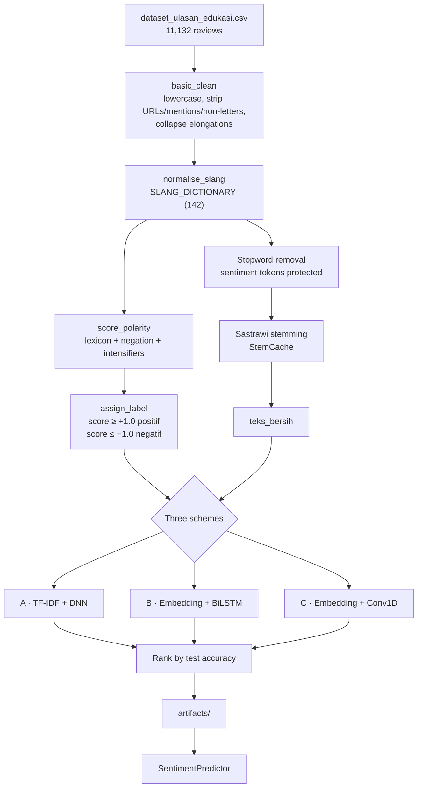

<div align="center">

# Sentiment Analysis of Educational App Reviews

**Three-class sentiment classification of Indonesian Google Play reviews for education apps,<br/>using lexicon-based weak labeling and three deep-learning training schemes.**


</div>

---

## Summary

| | |
|---|---|
| **Task** | Classify review text as `negatif`, `netral`, or `positif` |
| **Data** | `dataset_ulasan_edukasi.csv` — 11,132 Google Play reviews from 8 education apps |
| **Labels** | Generated by a weighted Indonesian sentiment lexicon with negation and intensifier handling |
| **Models compared** | A · TF-IDF + Dense DNN  ·  B · Embedding + BiLSTM  ·  C · Embedding + Conv1D |
| **Persisted model** | Scheme C (`artifacts/model_sentimen.keras`) |
| **Recorded test accuracy** | 0.8697 (macro-F1 0.8658) on a 30 % stratified hold-out — see [Results](#results) and [Known issues](#known-issues-and-reproducibility-notes) |
| **Entry point** | `Training_2.py` (single notebook; no package, CLI, or test suite) |


## Contents

- [Analisis Sentimen Ulasan Aplikasi Edukasi](#analisis-sentimen-ulasan-aplikasi-edukasi)
  - [Summary](#summary)
  - [Contents](#contents)
  - [Overview](#overview)
  - [Repository structure](#repository-structure)
  - [Dataset](#dataset)
    - [Sources](#sources)
    - [Schema](#schema)
  - [Pipeline](#pipeline)
    - [1 · Preprocessing (`preprocess_corpus`, §5.2)](#1--preprocessing-preprocess_corpus-52)
    - [2 · Lexicon-based labelling (§5–5.3)](#2--lexicon-based-labelling-553)
    - [3 · Label validation against ratings (§5.4)](#3--label-validation-against-ratings-54)
  - [Experimental design](#experimental-design)
  - [Results](#results)
    - [Scheme comparison](#scheme-comparison)
    - [Best model — Scheme C, per-class performance (test set, n = 3,339)](#best-model--scheme-c-per-class-performance-test-set-n--3339)
    - [Recorded inference examples (§16)](#recorded-inference-examples-16)
  - [Getting started](#getting-started)
    - [Prerequisites](#prerequisites)
    - [Installation](#installation)
    - [Running the pipeline](#running-the-pipeline)
  - [Running inference](#running-inference)
  - [Configuration reference](#configuration-reference)
  - [Known issues and reproducibility notes](#known-issues-and-reproducibility-notes)
  - [Methodological limitations](#methodological-limitations)
  - [Rubric compliance matrix](#rubric-compliance-matrix)
  - [Glossary](#glossary)
  - [License and data use](#license-and-data-use)

---

## Overview

This project is a self-contained research notebook. It takes raw Indonesian app reviews, normalises informal language, assigns sentiment labels with a hand-built lexicon, and then trains and compares three neural classifiers that learn to reproduce those labels from text. The best scheme (by test accuracy) is saved to `artifacts/` and reloaded through a `SentimentPredictor` class for categorical inference.

The notebook is organised as a 17-section workflow and is written in Indonesian (identifiers, comments, and printed output). It also contains a compliance section that scores the run against an assessment rubric of *Kriteria Utama* (main criteria) and *Saran* (suggestions).

**Implemented in the notebook**

- Dataset discovery across several candidate paths, plus integrity checks (required columns, empty-text removal)
- A seven-stage Indonesian text-preprocessing pipeline with a 142-entry slang dictionary and cached Sastrawi stemming
- A weighted polarity scorer with a negation window, intensifiers/downtoners, and optional quantile threshold calibration
- Label validation against star ratings (agreement, Cohen's κ, Spearman ρ)
- Three training schemes that share a common training and evaluation harness (`run_experiment`)
- A comparison table, learning curves, a classification report, and confusion matrices
- Artifact persistence (model, vocabulary or TF-IDF vectoriser, metadata) and a reload-and-predict class
- An automated rubric compliance matrix

**Not included in the archive**

- The data-collection code. The notebook's error message points to `scraping_code.ipynb`, and `requirements.txt` lists `google-play-scraper==1.2.7`, but no scraping script is shipped.
- A license, an author or citation file, automated tests, CI configuration, or a standalone inference module.

---

## Repository structure

```text
.
├── Training_2.py      # End-to-end pipeline (58 cells: 32 code, 26 markdown)
├── dataset_ulasan_edukasi.csv    # 11,132 reviews × 11 columns
├── requirements.txt              # Python dependencies
├── artifacts/
│   ├── model_sentimen.keras      # Persisted Scheme C model (Keras 3 format, 8.55 MB incl. optimizer state)
│   ├── kosakata_sequence.json    # TextVectorization vocabulary — 6,715 entries incl. "" and "[UNK]"
│   └── metadata_model.json       # Scheme, sequence length, classes, metrics, thresholds, timestamp
└── docs/
    └── figures/                  # PNGs extracted from the notebook's saved outputs (shipped with this README)
```

---

## Dataset

### Sources

| App (`nama_aplikasi`) | Package (`app_id`) | Reviews |
|---|---|---:|
| Ruangguru | `com.ruangguru.livestudents` | 2,106 |
| Duolingo | `com.duolingo` | 2,014 |
| Google Classroom | `com.google.android.apps.classroom` | 1,927 |
| Photomath | `com.microblink.photomath` | 1,888 |
| Brainly | `co.brainly` | 1,813 |
| Udemy | `com.udemy.android` | 730 |
| Khan Academy | `org.khanacademy.android` | 392 |
| Coursera | `org.coursera.android` | 262 |
| **Total** | | **11,132** |

Star ratings are close to uniform (1★ 2,352 · 2★ 2,193 · 3★ 2,143 · 4★ 1,975 · 5★ 2,469). Review timestamps range from 2014-03-12 to 2026-07-22. Reviews are short: the mean is 13.9 words, the median 9, the 95th percentile 44, and the maximum 98.

### Schema

| Column | Description |
|---|---|
| `review_id` | Unique review identifier (all 11,132 unique) |
| `ulasan` | Review text (raw) |
| `rating` | Star rating, 1–5 |
| `jumlah_suka` | Number of likes ("thumbs up") on the review |
| `tanggal_ulasan` | Review timestamp, `M/D/YYYY H:MM` |
| `versi_aplikasi` | App version at review time (empty for 3,187 rows) |
| `app_id` | Google Play package name |
| `nama_aplikasi` | App display name |
| `sentimen` | Rating-derived label: 1–2★ → `negatif`, 3★ → `netral`, 4–5★ → `positif` (matches for all 11,132 rows) |
| `panjang_karakter` | Character length of `ulasan` |
| `jumlah_kata` | Word count of `ulasan` |

The CSV contains no reviewer names or user handles.

<p align="center">
  
  <br/><sub><i>Notebook §3.1: rating distribution, contribution per app, and review length in words.</i></sub>
</p>

---

## Pipeline



### 1 · Preprocessing (`preprocess_corpus`, §5.2)

| Stage | Operation | Implementation |
|---|---|---|
| 1–3 | Lowercase; remove URLs, `@`/`#` mentions, and non-letter characters; collapse runs of 3+ repeated characters | `basic_clean` with `RE_URL`, `RE_MENTION`, `RE_NON_ALPHA`, `RE_ELONGATION` |
| 4 | Expand informal and slang tokens to standard forms (e.g. `gak` → `tidak`, `lemot` → `lambat`) | `normalise_slang` + `SLANG_DICTIONARY` (142 entries) |
| 5 | **Polarity scoring runs here**, on normalised tokens, *before* stopwords are removed | `score_polarity` |
| 6 | Stopword removal, keeping sentiment terms, negators, and intensifiers | `ACTIVE_STOPWORDS` (118 of Sastrawi's 123; `agak`, `amat`, `belum`, `tanpa`, `tidak` are protected) |
| 7 | Stemming, memoised per token type | `StemCache` around Sastrawi's `StemmerFactory` |

In the recorded run, stemming 10,390 token types took 1,142.9 s on CPU, which was nearly all of the 1,143.6 s preprocessing time. Four reviews were empty after preprocessing and were dropped, leaving **11,128** samples.

### 2 · Lexicon-based labelling (§5–5.3)

- **Lexicon:** 81 positive and 74 negative weighted entries (±1.0 moderate, ±2.0 strong), tuned for app-review vocabulary.
- **Negation:** any of 9 negators (`tidak`, `tak`, `bukan`, `jangan`, `belum`, `kurang`, `tanpa`, `gagal`, `hindari`) flips the sign of sentiment terms that follow it. The countdown starts at `negation_window + 1`, so with the default `negation_window = 2` the scope is the next **3** tokens. Intensifiers extend the scope.
- **Intensity:** 17 intensifiers and downtoners scale the next sentiment term (e.g. `sangat` ×1.6, `agak` ×0.6).
- **Thresholds:** `positif` if score ≥ +1.0, `negatif` if score ≤ −1.0, otherwise `netral`. If any class falls below 8 % (`min_class_share`), `calibrate_thresholds` re-derives the thresholds from the 15th and 85th score percentiles. In the recorded run this step was **not triggered**: the smallest class held 21.1 %.

**Recorded label distribution**

| Class | Count | Share |
|---|---:|---:|
| `negatif` | 2,348 | 21.10 % |
| `netral` | 5,006 | 44.99 % |
| `positif` | 3,774 | 33.91 % |

### 3 · Label validation against ratings (§5.4)

| Statistic | Value |
|---|---:|
| Three-class agreement (lexicon vs. rating-derived) | 46.7 % |
| Polarity-direction agreement (both labels non-neutral) | 82.1 % |
| Cohen's κ | 0.229 |
| Spearman ρ (lexicon score vs. star rating) | 0.471 |

The mean lexicon score rises monotonically from about −0.5 at 1★ to about +1.4 at 5★. Most disagreements involve the neutral class: 2,212 reviews with 1–2★ ratings and 1,739 with 4–5★ ratings receive the lexicon label `netral`.

<p align="center">
  
  <br/><sub><i>Notebook §5.4: polarity-score histogram with thresholds, class balance, and mean score per star rating.</i></sub>
</p>

---

## Experimental design

The three schemes share one harness (`run_experiment`, §9). It applies a stratified train/test split, fits the feature extractor on the training portion only, holds out a stratified 10 % validation subset, and trains with balanced class weights.

| | **Scheme A** | **Scheme B** | **Scheme C** |
|---|---|---|---|
| Features | TF-IDF, n-grams (1, 2), `min_df=2`, `sublinear_tf=True` | `TextVectorization` sequences | `TextVectorization` sequences |
| Vocabulary cap | 3,000 | 15,000 | 10,000 |
| Sequence length / embedding | — | 100 / 128 | 60 / 100 |
| Architecture | Dense 256 → BN → Dropout 0.4 → Dense 128 → BN → Dropout 0.3 | SpatialDropout1D 0.3 → BiLSTM(64) → GlobalMaxPool → Dense 64 → Dropout 0.3 | SpatialDropout1D 0.3 → Conv1D(128, k=5) → GlobalMaxPool → Dense 64 → Dropout 0.3 |
| Train / test split | 80 / 20 | 80 / 20 | 70 / 30 |
| Train / test matrix | (8,902, 3,000) / (2,226, 3,000) | (8,902, 100) / (2,226, 100) | (7,789, 60) / (3,339, 60) |
| Trainable parameters | 802,307 | 1,028,227 | 744,079 |

<details>
<summary><b>Shared training configuration</b></summary>

| Setting | Value |
|---|---|
| Optimizer | Adam, `learning_rate = 1e-3` |
| Loss | `sparse_categorical_crossentropy` |
| Output | `Dense(3, softmax)` named `keluaran` |
| Batch size / max epochs | 128 / 30 |
| Early stopping | monitor `val_accuracy`, `patience = 5`, `restore_best_weights = True` |
| LR schedule | `ReduceLROnPlateau` on `val_loss`, `factor = 0.5`, `patience = 2`, `min_lr = 1e-5` |
| Class weights | `compute_class_weight("balanced")` on the fit subset |
| Seed | `SEED = 42` (Python, NumPy, TensorFlow, `PYTHONHASHSEED`) |
| Class index mapping | `negatif` → 0, `netral` → 1, `positif` → 2 |

</details>

<details>
<summary><b>Persisted model (Scheme C) — layer-by-layer</b></summary>

Read from `artifacts/model_sentimen.keras` → `config.json` (Sequential model `cnn1d_sequence`):

| # | Layer | Configuration | Trainable params |
|---|---|---|---:|
| 1 | `InputLayer` `masukan_urutan` | shape `(None, 60)`, int32 | 0 |
| 2 | `Embedding` | `input_dim = 6715`, `output_dim = 100` | 671,500 |
| 3 | `SpatialDropout1D` | rate 0.3 | 0 |
| 4 | `Conv1D` | 128 filters, kernel 5, ReLU, `padding="same"` | 64,128 |
| 5 | `GlobalMaxPooling1D` | — | 0 |
| 6 | `Dense` | 64, ReLU | 8,256 |
| 7 | `Dropout` | rate 0.3 | 0 |
| 8 | `Dense` `keluaran` | 3, softmax | 195 |
| | **Total** | | **744,079** |

The embedding uses 6,715 rows rather than the 10,000 cap because the training split contains only 6,715 vocabulary entries. The optimizer state saved in the file records a learning rate of 2.5 × 10⁻⁴, which means `ReduceLROnPlateau` halved the initial rate twice.

</details>

---

## Results

### Scheme comparison

| Rank | Scheme | Train acc.¹ | Test acc. | Macro-F1 | Macro-P | Macro-R | Epochs | Time (s) |
|:---:|---|---:|---:|---:|---:|---:|---:|---:|
| 1 | **C · Conv1D** | 0.9162 | **0.8697** | **0.8658** | 0.8586 | 0.8785 | 9 | 22.1 |
| 2 | B · BiLSTM | 0.8909 | 0.8288 | 0.8194 | 0.8164 | 0.8272 | 8 | 113.5 |
| 3 | A · TF-IDF DNN | 0.9762 | 0.7857 | 0.7767 | 0.7794 | 0.7743 | 22 | 31.5 |

<sub>¹ Train accuracy is computed on the full training portion, including the 10 % validation subset (`model.evaluate(x_train, y_train)`).</sub>

Scheme A has the largest generalisation gap (0.191 between train and test accuracy). Its learning curve shows training accuracy near 1.0 while validation accuracy levels off around 0.79. Scheme C's validation accuracy peaks at the 4th epoch. Training stopped after 9 epochs (patience 5), and early stopping restored the 4th-epoch weights.

<p align="center">
  
  <br/><sub><i>Notebook §13: accuracy against the rubric thresholds (85 % minimum, 92 % target) and per-scheme learning curves.</i></sub>
</p>

### Best model — Scheme C, per-class performance (test set, n = 3,339)

| Class | Precision | Recall | F1 | Support |
|---|---:|---:|---:|---:|
| `negatif` | 0.7880 | 0.8965 | 0.8388 | 705 |
| `netral` | 0.9326 | 0.8202 | 0.8728 | 1,502 |
| `positif` | 0.8553 | 0.9187 | 0.8859 | 1,132 |
| *macro avg* | 0.8586 | 0.8785 | 0.8658 | 3,339 |
| *weighted avg* | 0.8759 | 0.8697 | 0.8701 | 3,339 |

<details>
<summary><b>Confusion matrix (rows = actual, columns = predicted)</b></summary>

| | `negatif` | `netral` | `positif` |
|---|---:|---:|---:|
| **`negatif`** | **632** | 47 | 26 |
| **`netral`** | 120 | **1,232** | 150 |
| **`positif`** | 50 | 42 | **1,040** |

Most errors are neutral reviews predicted as polar: 270 of 1,502 (18 %).

</details>

<p align="center">
  
  <br/><sub><i>Notebook §14: confusion matrices (counts and row proportions) and loss curves for Scheme C.</i></sub>
</p>

### Recorded inference examples (§16)

<details>
<summary><b>Hand-written test sentences — 9 cases</b></summary>

| Intended | Text | Predicted | Confidence |
|---|---|---|---:|
| positive | Aplikasi ini sangat membantu saya memahami materi matematika, penjelasannya jelas dan lengkap. | `positif` | 99.42 % |
| positive | Fiturnya lengkap, gurunya ramah, dan harganya terjangkau untuk pelajar. | `positif` | 63.52 % |
| positive | Materi tersusun rapi dan mudah dipahami, sangat direkomendasikan untuk belajar mandiri. | `positif` | 99.15 % |
| negative | Aplikasinya sering error dan lemot sekali, sudah bayar langganan tapi materi tidak bisa dibuka. | `negatif` | 99.65 % |
| negative | Sangat mengecewakan, iklannya terlalu banyak dan sering keluar sendiri saat sedang belajar. | `negatif` | 99.83 % |
| negative | Materi sedikit tapi harganya mahal sekali, saya menyesal berlangganan aplikasi ini. | `negatif` | 96.52 % |
| neutral / mixed | Aplikasi lumayan, ada beberapa fitur yang perlu diperbaiki tetapi masih bisa digunakan. | `positif` | 94.07 % |
| neutral / mixed | Saya baru memakai aplikasi ini selama tiga hari untuk mengerjakan tugas sekolah. | `netral` | 90.24 % |
| negation | Aplikasi ini tidak membantu sama sekali dan penjelasannya tidak jelas. | `negatif` | 80.22 % |

On 10 randomly sampled dataset reviews (`random_state=42`), 8 of 10 predictions matched the lexicon label.

</details>

---

## Getting started

### Prerequisites

- Python **3.13** (the recorded kernel was 3.13.13)
- Jupyter (Notebook or Lab). It is **not** listed in `requirements.txt`.
- No GPU is required. The recorded run used CPU only. Stemming in §5.2 took about 19 minutes in that run; your time will depend on hardware.

### Installation

```bash
# from the project root
python -m venv .venv
source .venv/bin/activate            # Windows: .venv\Scripts\activate

pip install -r requirements.txt
pip install jupyter                   # not included in requirements.txt
```

Pinned versions in `requirements.txt`:

| Package | Version | Imported by the notebook? |
|---|---|:---:|
| `tensorflow` | 2.21.0 | ✔ |
| `pandas` | 3.0.4 | ✔ |
| `numpy` | 2.5.0 | ✔ |
| `scikit-learn` | 1.9.0 | ✔ |
| `matplotlib` | 3.11.0 | ✔ |
| `Sastrawi` | unpinned (the notebook's first cell runs `%pip install Sastrawi==1.0.1`) | ✔ |
| `seaborn` | 0.13.2 | — |
| `google-play-scraper` | 1.2.7 | — (used for data collection, which is not included) |
| `nltk`, `gensim` | unpinned | — |

`joblib` is imported but not listed. It is installed as a dependency of scikit-learn.

### Running the pipeline

```bash
Training_2.py
```

Launch or convert the python to Jupyter from the project root. `resolve_dataset_path` searches these locations in order and uses the first one it finds:

```text
output/dataset_ulasan_edukasi.csv
dataset_ulasan_edukasi.csv              ← location in this archive
/content/dataset_ulasan_edukasi.csv     ← Google Colab
/content/output/dataset_ulasan_edukasi.csv
../output/dataset_ulasan_edukasi.csv
```

> [!WARNING]
> Running §15 overwrites the contents of `artifacts/`. Back up the shipped model first if you want to keep it. Also read [Known issues](#known-issues-and-reproducibility-notes) **before** a full re-run: one bug changes which labels the models train on.

---

## Running inference

`SentimentPredictor` is defined inside the notebook (§16). There is no importable module. It reapplies the training-time preprocessing (`basic_clean` → `normalise_slang` → `ACTIVE_STOPWORDS` filter → Sastrawi stem) before vectorising, so those definitions must exist in the session.

To use the shipped artifacts **without retraining**:

1. Run §1–§4 and the first code cell of §5 (the cell that defines `ACTIVE_STOPWORDS`).
2. Define the artifact paths. The §16 cell expects a variable named `ARTIFACT_PATHS`:

   ```python
   ARTIFACT_PATHS = {
       "model": "artifacts/model_sentimen.keras",
       "vectorizer": "artifacts/kosakata_sequence.json",
       "metadata": "artifacts/metadata_model.json",
   }
   ```

3. Run the §16 cell. It defines `SentimentPredictor` and builds `PREDICTOR`. Then call:

   ```python
   PREDICTOR.predict_one("Penjelasan materinya sangat bagus dan mudah dimengerti.")
   # -> {"teks": ..., "sentimen": "positif" | "netral" | "negatif", "keyakinan": float}

   PREDICTOR.predict(["teks pertama", "teks kedua"])
   # -> DataFrame: teks, sentimen_prediksi, keyakinan, prob_negatif, prob_netral, prob_positif
   ```

**Model I/O contract** (for use outside the notebook): the input is an `int32` tensor of shape `(batch, 60)` produced by a `TextVectorization(standardize=None, split="whitespace", output_sequence_length=60)` layer whose vocabulary is loaded from `kosakata_sequence.json`. Drop the `""` and `"[UNK]"` entries before `set_vocabulary`, because the layer adds them back. The output is softmax probabilities in the order given by `metadata_model.json → "kelas"`: `["negatif", "netral", "positif"]`.

<details>
<summary><b><code>artifacts/metadata_model.json</code> fields</b></summary>

| Key | Recorded value | Meaning |
|---|---|---|
| `kode_skema` / `nama_skema` | `"C"` / `"Sequence Embedding + CNN 1D"` | Winning scheme |
| `jenis_fitur` / `arsitektur` | `"sequence"` / `"cnn"` | Selects the vocabulary-JSON loader (vs. `vectorizer_tfidf.joblib` for TF-IDF) |
| `panjang_urutan` | `60` | Sequence length |
| `max_features` | `10000` | Vocabulary cap (actual vocabulary: 6,715) |
| `kelas` | `["negatif", "netral", "positif"]` | Output index order |
| `akurasi_latih` / `akurasi_uji` / `f1_makro` | 0.9162 / 0.8697 / 0.8658 | Recorded metrics |
| `ambang_positif` / `ambang_negatif` | `1.0` / `-1.0` | Labelling thresholds in effect |
| `disimpan_pada` | `2026-07-23T23:49:53` | Save timestamp |

</details>

---

## Configuration reference

All tunables are frozen dataclasses in §2 and §6. Edit them in place before running the notebook.

<details>
<summary><b><code>LabelingConfig</code> · <code>TrainingConfig</code> · <code>SchemeSpec</code></b></summary>

**`LabelingConfig`**

| Field | Default | Role |
|---|---|---|
| `positive_threshold` | `1.0` | Minimum score for `positif` |
| `negative_threshold` | `-1.0` | Maximum score for `negatif` |
| `negation_window` | `2` | Tokens affected after a negator |
| `min_class_share` | `0.08` | Triggers quantile recalibration if any class is below this share |
| `target_min_share` | `0.15` | Quantile used when recalibrating |

**`TrainingConfig`**

| Field | Default | Role |
|---|---|---|
| `epochs` | `30` | Maximum epochs |
| `batch_size` | `128` | |
| `validation_share` | `0.10` | Validation fraction of the training portion |
| `early_stopping_patience` | `5` | |
| `reduce_lr_patience` | `2` | |
| `learning_rate` | `1e-3` | Adam initial LR |
| `random_state` | `42` | |
| `target_accuracy` | `0.92` | Rubric "Saran 2" target |
| `minimum_accuracy` | `0.85` | Rubric "Kriteria Utama 4" floor |
| `minimum_samples` | `10_000` | Rubric "Saran 4" floor |
| `artifact_dir` | `"artifacts"` | Output directory |

**`SchemeSpec`** fields: `code`, `name`, `feature_kind` (`"tfidf"` \| `"sequence"`), `architecture` (`"dense"` \| `"bilstm"` \| `"cnn"`), `test_size`, `max_features`, `ngram_range`, `sequence_length`, `embedding_dim`. The three instances are in the `SCHEMES` tuple.

</details>

---

## Known issues and reproducibility notes

> [!IMPORTANT]
> **Label-column mismatch: the saved source may not reproduce the recorded results.**
> In §5.3, the lexicon labels are written to `df_prep["sentiment"]` (English spelling). Everything downstream reads `df_prep["sentimen"]` instead: §5.4 validation, the diagnostics plot, `run_experiment`, inference comparison, and the compliance matrix. In the shipped CSV, `sentimen` is the **rating-derived** label. The saved outputs (the §5.4 crosstab column totals 2,348 / 5,006 / 3,774 and the §5.5 samples) show that `sentimen` held **lexicon** labels when those outputs were produced. A clean *Restart & Run All* of the saved source would therefore train on rating-derived labels, so do not assume it reproduces the recorded metrics.
>
> **Fix:** in §5.3, assign the lexicon labels to `df_prep["sentimen"]`, and change the two later references to `"sentiment"` in the same cell.

| Issue | Location | Effect |
|---|---|---|
| Non-linear execution history | whole notebook | Execution counts run from 1 to 138 with gaps. The §4.1 and §5.1 code cells have saved outputs but no execution count, so the saved state does not come from a single top-to-bottom run. |
| Logging call without a format string | `calibrate_thresholds`, §5.3 | `LOGGER.warning(neg_threshold, pos_threshold)` causes Python's logging module to print a `--- Logging error ---` traceback, and the intended warning is lost. Execution continues. The bug is dormant here because calibration was not triggered. |
| Negation scope is one token wider than configured | `score_polarity`, §5.1 | The countdown starts at `window + 1`, so `negation_window = 2` negates sentiment terms up to 3 tokens after a negator. |
| Multi-word lexicon entries never match | §5 lexicons | `score_polarity` checks single tokens only, so entries such as `"luar biasa"`, `"terima kasih"`, `"sia sia"`, `"keluar sendiri"`, `"tidak stabil"`, `"benar benar"`, and `"sedikit banyak"` have no effect. |
| `gagal` is both a negator and a −2.0 term | §5 lexicons | The negator check runs first, so `gagal` flips the polarity of the terms that follow it but never contributes its own −2.0. |
| Duplicate key | `POSITIVE_LEXICON` | `"sukses"` is defined twice (harmless). |
| Dependency drift | `requirements.txt` | See the [installation table](#installation): Jupyter and `joblib` are not listed; four listed packages are unused; Sastrawi, `nltk`, and `gensim` are unpinned. |

---

## Methodological limitations

- **Weak supervision.** The targets are lexicon outputs, not human annotations. Test accuracy therefore measures how well the model **reproduces the lexicon's decision rule**, not agreement with human-judged sentiment. Agreement between the lexicon and star ratings is weak (κ = 0.229), and the recorded examples include visible label noise (e.g. a 2★ crash complaint labelled `positif`).
- **Confounded comparison.** The schemes differ in features, architecture, vocabulary, sequence length, **and** test split at the same time. Scheme C is also evaluated on a different, larger (30 %) test partition. Performance differences cannot be attributed to any single factor.
- **Selection on the test set.** The best scheme is chosen by test accuracy, so its reported test score is optimistically biased as an estimate of generalisation.
- **Single seed, single split.** No repeated runs, cross-validation, or confidence intervals are reported.
- **Neutral-class ambiguity.** Mixed reviews (e.g. *"Aplikasi lumayan, … perlu diperbaiki …"*) are confidently predicted as `positif`. Neutral→polar confusions are the largest error source.
- **App imbalance.** Five apps contribute 88 % of reviews. Per-app performance is not reported.

---

## Rubric compliance matrix

Reproduced from the notebook's §17 output. **9 of 11 items pass.**

| Item | Requirement | Recorded actual | Status |
|---|---|---|:---:|
| Kriteria Utama 1 | Self-scraped data, ≥ 3,000 samples | 11,128 samples | ✅ |
| Kriteria Utama 2 | Feature extraction and data labelling | Weighted lexicon + TF-IDF/Sequence | ✅ |
| Kriteria Utama 3 | Machine-learning training algorithm | BILSTM, CNN, DENSE | ✅ |
| Kriteria Utama 4 | Test accuracy ≥ 85 % | 86.97 % (best) | ✅ |
| Saran 1 | Deep-learning algorithm | 3 neural architectures | ✅ |
| Saran 2 | Train **and** test accuracy > 92 % | Not met by any scheme | ⚠️ |
| Saran 2 (cont.) | Other schemes ≥ 85 % | A and B below 85 % | ⚠️ |
| Saran 3 | ≥ 3 classes | 3: negatif, netral, positif | ✅ |
| Saran 4 | ≥ 10,000 samples | 11,128 samples | ✅ |
| Saran 5 | Three schemes, ≥ 2 distinct combinations | 3 schemes, 3 dimensions varied | ✅ |
| Saran 6 | Inference outputs a categorical class | 9 test sentences + 10 real samples | ✅ |

<sub>Kriteria Utama 1 is scored on sample count only. The scraping code is not in the archive.</sub>

---

## Glossary

| Indonesian | English | | Indonesian | English |
|---|---|---|---|---|
| ulasan | review | | skema | scheme |
| sentimen | sentiment | | akurasi latih / uji | train / test accuracy |
| negatif · netral · positif | negative · neutral · positive | | kosakata | vocabulary |
| skor polaritas | polarity score | | ambang | threshold |
| teks bersih | cleaned text | | keyakinan | confidence |
| pelabelan | labelling | | keluaran / masukan | output / input |
| LULUS / PERIKSA ULANG | pass / re-check | | Kriteria Utama / Saran | main criterion / suggestion |

---
