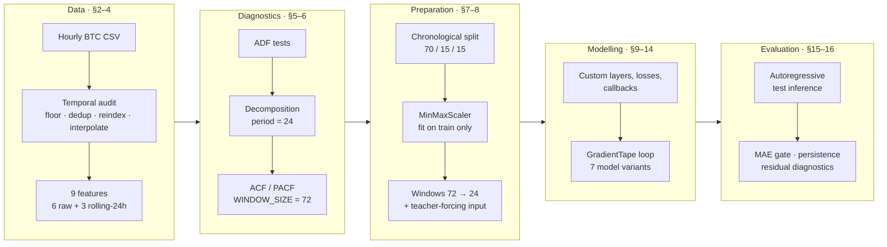
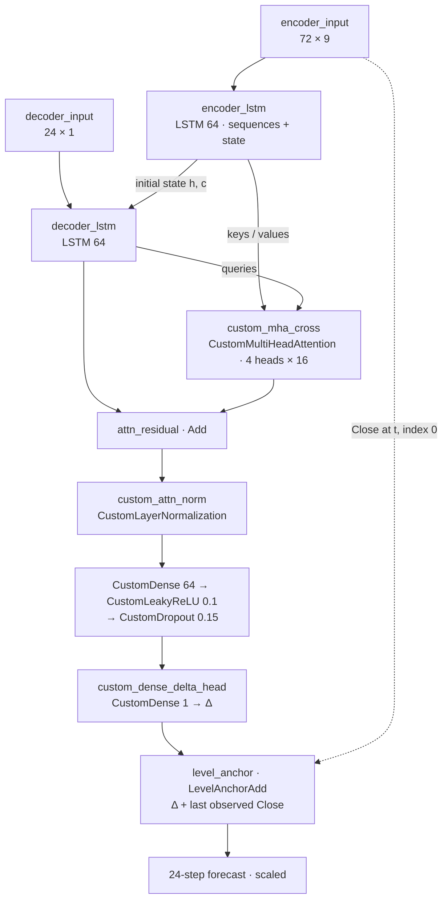

<div align="center">

# 📈 Multivariate Seq2Seq LSTM Forecasting of Hourly Bitcoin Prices

**A fully custom TensorFlow/Keras pipeline that forecasts the next 24 hourly Bitcoin closing prices from a 72-hour, 9-feature window.**
<br/>It uses level-anchored residual decoding, layers written from scratch, custom losses and callbacks, and a hand-written `GradientTape` training loop.

[](#prerequisites)
[](requirements.txt)
[](requirements.txt)
[](#getting-started)

</div>

> [!NOTE]
> **Language.** Section headings and analytical commentary are in English. Code comments, printed diagnostics, table headers, and plot labels are mostly in **Bahasa Indonesia**. A [glossary](#glossary) translates the terms that appear in the outputs.

---

<a id="overview"></a>
## 📖 Overview

The project forecasts **multi-step (24-hour) Bitcoin `Close` prices** from hourly multivariate market data covering 2017–2023. Bitcoin's price level is a non-stationary, trend-dominated series. A network trained on it naively tends to regress toward the training-set mean. This pipeline counters that in two ways:

1. **Statistical diagnosis first:** ADF tests, seasonal decomposition, and ACF/PACF analysis guide the window size, feature set, and architecture.
2. **Level-anchored residual decoding:** Every model predicts a *change* (Δ) and adds it to the last observed close through a custom `LevelAnchorAdd` layer. This turns the ADF result into a structural constraint on the architecture.

All models are scored on a held-out, chronologically final test set using **autoregressive decoding**. They are compared against a **persistence (random-walk) benchmark** and a pre-set MAE threshold.

**Who it is for:** The code is organized as a graded deep-learning time-series project. It references numbered assessment criteria, a rejection rule that makes MAE the primary metric, and an "advanced" MAE gate. Beyond assessment, it serves as a worked reference for anyone learning how to build Keras components from first principles: custom layers, losses, callbacks, and training loops.

**What kind of project this is:** A single-script research and coursework pipeline plus three trained model artifacts. It is not a library or a deployable application.

---

<a id="key-features"></a>
## ✨ Key Features

| Area | What is implemented |
|---|---|
| 🧹 **Temporal data audit** | Off-grid timestamp detection, duplicate and monotonicity checks, hour-grid gap census, `floor("h")` → de-duplication → full-grid reindex → time interpolation |
| 📐 **Statistically grounded design** | ADF stationarity tests (level vs. first difference), additive decomposition (period = 24), ACF/PACF significance analysis used to justify `WINDOW_SIZE = 72` |
| 🔒 **Leakage-safe preprocessing** | Chronological 70/15/15 split; `MinMaxScaler` fitted **on the training partition only**, enforced by `assert` statements |
| 🧱 **Six layers written from scratch** | `CustomDense`, `CustomMultiHeadAttention`, `CustomDropout`, `CustomLayerNormalization`, `CustomLeakyReLU`, `LevelAnchorAdd`, each checked numerically against its Keras reference or intended behavior |
| 🎯 **Two custom losses** | `custom_mae_loss` and `HorizonWeightedMAELoss`, which weights later forecast steps more heavily |
| ⏱️ **Custom callback framework** | `CustomEarlyStopping`, `CustomReduceLROnPlateau`, `CustomPredictionPlotCallback`, all built on a hand-written `CustomCallback` base class |
| 🔁 **Hand-written training loop** | `train_with_gradient_tape()` with `tf.function`-compiled steps and global-norm gradient clipping. `model.fit` is never used. |
| 🧠 **Seven model variants** | Baseline vs. Seq2Seq, Functional API vs. Model Subclassing, with or without Keras or custom multi-head attention |
| 🧪 **Strict evaluation protocol** | Autoregressive test decoding, measurement of exposure bias (teacher-forced vs. autoregressive error), a persistence benchmark, per-horizon error curves, and residual diagnostics |
| 💾 **Serialization-ready** | Every custom class is registered with `@keras.saving.register_keras_serializable(package="DLTM")` |

---

<a id="contents"></a>
## 🧭 Contents

- [Overview](#overview) · [Key Features](#key-features) · [Technology Stack](#technology-stack)
- [Methodology](#methodology) · [Model Zoo](#model-zoo)
- [Getting Started](#getting-started) · [Usage](#usage) · [Interpreting the Outputs](#interpreting-the-outputs)
- [Project Structure](#project-structure) · [Configuration](#configuration) · [Development and Testing](#development-and-testing)
- [Troubleshooting and Limitations](#troubleshooting-and-limitations) · [License and Credits](#license-and-credits)

---

<a id="technology-stack"></a>
## 🛠️ Technology Stack

Versions are taken from [`requirements.txt`](requirements.txt).

| Package | Version | Role in this project |
|---|---|---|
| **TensorFlow** | `2.21.0` | Tensor ops, `tf.data` input pipelines, `tf.GradientTape`, `tf.function` graph compilation |
| **Keras** | `3.15.0` | Functional and Subclassing APIs, reference `LSTM` / `MultiHeadAttention` layers, `.keras` serialization, Adam optimizer |
| **NumPy** | `2.5.0` | Sliding-window tensor construction, metric computation |
| **pandas** | `3.0.4` | Time indexing, reindexing and interpolation, rolling features, styled result tables (see [yanked release](#troubleshooting-and-limitations)) |
| **scikit-learn** | `1.9.0` | `MinMaxScaler` for features and target |
| **statsmodels** | `0.14.6` | `adfuller`, `seasonal_decompose`, `acf`/`pacf` and their plots, Q-Q plot |
| **matplotlib** / **seaborn** | `3.11.0` / `0.13.2` | Time-series plots, correlation heatmaps, learning curves, forecast charts |

**Needed but not pinned in `requirements.txt`:**

| Package | Why it is needed |
|---|---|
| Jupyter / IPython | Supplies the `display()` function used 12 times |
| Jinja2 | Required by the 11 pandas `Styler` calls (`.style.format`, `background_gradient`) |
| `jupytext` | Converts the script into a notebook |
| `pydot` + Graphviz | Optional; only for `keras.utils.plot_model`, which is skipped gracefully if missing |

---

<a id="methodology"></a>
## 🔬 Methodology

### Pipeline



### Data provenance

- **Source.** The script describes the data as *"Multivariate Crypto Data Hourly since 2017 to 2023"*. It downloads the CSV from a Google Drive direct-download link stored in `csv_url` (§2). If that fails, it falls back to a local file named `Bitcoin3.csv`, which is **not included** in the archive.
- **Expected columns.** `Date` (parsed with `format="ISO8601"`), `Close`, `Volume USDT`, `RSI`, `MACD_Hist`, `ATR`, `KAMAO`. The archive does not document the indicator parameters or exactly how `KAMAO` is defined.
- **Engineered features (§4).** `Close_roll_mean_24`, `Close_roll_std_24`, and `Volume_roll_mean_24` are trailing 24-hour rolling statistics. The 23 warm-up rows are dropped.
- **Final input order.** This is `FEATURES` (target at index 0): `Close`, `Volume USDT`, `RSI`, `MACD_Hist`, `ATR`, `KAMAO`, `Close_roll_mean_24`, `Close_roll_std_24`, `Volume_roll_mean_24`.
- **Licensing.** The archive gives no license or attribution terms for the dataset. Check them before you redistribute the data.

### Preprocessing and windowing

| Step | Implementation |
|---|---|
| Gap handling | Reindex to a complete hourly grid, then `interpolate(method="time").ffill().bfill()` |
| Split | `df.iloc` chronological slices of 70 / 15 / 15 %. An assertion checks `train < validation < test`. |
| Scaling | A `feature_scaler` and a separate `target_scaler` (both `MinMaxScaler(0, 1)`) are fitted on `df_train` only. Assertions confirm that `data_min_` and `data_max_` equal the training statistics. |
| Windowing | `create_windows()` yields `encoder_input (N, 72, 9)`, `decoder_input (N, 24, 1)`, and `y (N, 24, 1)`, where N = len − 72 − 24 + 1 |
| Teacher forcing | `decoder_input = [yₜ, yₜ₊₁, …, yₜ₊₂₃]`, i.e. the last observation followed by the targets shifted one step. This is verified by assertions. |
| Input pipeline | `tf.data` → `shuffle` (train only, seed 42) → `batch(128)` → `prefetch(AUTOTUNE)` |

### Findings recorded by the author

The markdown commentary in §4.2, §5.2, and §5.4 records the following results. They come from the author's run and **were not regenerated** for this README.

| Diagnostic | Recorded result | Design consequence in the code |
|---|---|---|
| Pearson *r*(Close, `Close_roll_mean_24`) | ≈ 0.99 | Explained by construction. The window is trailing, so this is not leakage. |
| Pearson *r*(Close, `ATR`) | ≈ 0.84 | Kept as a volatility-state feature |
| *r*(Close, `RSI` / `KAMAO` / `MACD_Hist`) | 0.04 / 0.02 / −0.02 | Kept in `FEATURES` despite near-zero linear correlation |
| Oscillator collinearity | RSI–KAMAO 0.75; KAMAO–MACD_Hist 0.50 | Partial redundancy accepted deliberately |
| ADF, `Close` level | p ≈ 0.50 → non-stationary | Motivates `LevelAnchorAdd` (§9.4, *"Operationalization of ADF Test Findings"*) |
| ADF, ΔClose | p ≈ 0.000 → stationary | ACF/PACF for window selection are computed on the differenced series |
| Variance decomposition | Trend > 99% of variance | Intraday seasonality is small. Heteroskedastic residuals justify keeping `ATR` and `Close_roll_std_24`. |

---

<a id="model-zoo"></a>
## 🧠 Model Zoo

All variants output `(batch, 24, 1)` in scaled space. An assertion in §13.3 enforces this.

|  | Model | API | Attention | Extra custom blocks | Loss | Max epochs | Test decoding | Shipped? |
|---|---|---|---|---|---|---|---|---|
| 1 | `model_baseline_LSTM` | Functional | — | — | MAE | 25 | Direct (24 at once) | ✅ 63,384 params |
| 2 | `model_seq2seq_LSTM` | Functional | — | — | MAE | 25 | Autoregressive, O(H²) | ✅ 40,065 params |
| 3 | `model_seq2seq_subclassed` | Subclassing | — | — | MAE | 6 | Autoregressive, O(H) state-passing | — |
| 4 | `model_baseline_LSTM_mha` | Functional | Keras MHA (self) | — | — | **not trained** ⚠️ | Direct | — |
| 5 | `model_seq2seq_LSTM_mha` | Functional | Keras MHA (cross) | — | MAE | 6 | Autoregressive, O(H²) | — |
| 6 | `model_baseline_LSTM_custom` | Functional | Custom MHA (self) | LeakyReLU, Dropout, LayerNorm | MAE | 6 | Direct | — |
| 7 | `best_model_seq2seq_LSTM` | Functional | Custom MHA (cross) | LeakyReLU, Dropout, LayerNorm | Horizon-weighted MAE | 25 | Autoregressive, O(H²) | ✅ 56,641 params |

Parameter counts for the shipped models come from their stored weight tensors and match the builder functions in `Training_3.py` exactly. "Max epochs" is an upper bound, because `CustomEarlyStopping` (patience 4) can end training earlier.

> [!IMPORTANT]
> The `best_` prefix is a name chosen in the code. The archive contains no evaluation results, so nothing in it establishes this variant as the top performer. Its ranking is only produced when the pipeline runs (§16).

### Architecture of `best_model_seq2seq_LSTM`



<details>
<summary><b>Custom components at a glance</b></summary>

| Component | Section | Behavior and validation in §9.5 |
|---|---|---|
| `CustomDense` | 9.1 | `tf.matmul` on the last axis, so it works on rank-3 inputs without `TimeDistributed`. Matches `layers.Dense` to within 1e-5 when weights are shared. |
| `CustomMultiHeadAttention` | 9.2 | Scaled dot-product attention with key = value. Q/K/V projections have no bias; only the output projection has one. Validated by output shape against Keras MHA. |
| `CustomDropout` | 9.3 | Inverted dropout. Returns its input unchanged at inference; E[x] ≈ 1 during training (tolerance 0.03). |
| `CustomLayerNormalization` | 9.3 | Per-position normalization with `gamma` and `beta`. Matches `layers.LayerNormalization` to within 1e-4. |
| `CustomLeakyReLU` | 9.3 | `max(αx, x)`. Matches `layers.LeakyReLU` to within 1e-6. |
| `LevelAnchorAdd` | 9.4 | Adds `encoder_input[:, -1, target_idx]` to the predicted Δ. With Δ = 0 the output equals the last close (tolerance 1e-6). |
| `custom_mae_loss` | 10 | Plain mean absolute error |
| `HorizonWeightedMAELoss` | 10 | Weights wₕ = 1.0 + 0.2·(h−1), normalized to mean 1 (≈ 0.30 → 1.70). With uniform weights it equals plain MAE, which an assertion checks. |
| `CustomEarlyStopping` | 11 | Monitors `val_loss`, patience 4, `min_delta` 1e-6, restores the best weights |
| `CustomReduceLROnPlateau` | 11 | Multiplies LR by 0.5 after 2 stagnant epochs, floor 1e-6 |
| `CustomPredictionPlotCallback` | 11 | Plots the first validation window every `max(EPOCHS_MAIN // 2, 1)` epochs |

</details>

---

<a id="getting-started"></a>
## 🚀 Getting Started

<a id="prerequisites"></a>
### Prerequisites

- **Python 3.12 or 3.13.** This range is derived from the pins: NumPy `2.5.0` requires Python ≥ 3.12, and TensorFlow `2.21.0` publishes wheels up to CPython 3.13.
- **Internet access** on the first run, to download the dataset from Google Drive. Alternatively, place a compatible `Bitcoin3.csv` next to the script.
- **A GPU is optional.** The script detects one automatically, enables memory growth, and warns that CPU training will be much slower.

### Installation

```bash
cd "Deep Learning_3"                      

python3.12 -m venv .venv
source .venv/bin/activate                 
python -m pip install --upgrade pip

pip install -r requirements.txt
pip install jupyterlab jupytext jinja2   
```

> [!WARNING]
> **pandas `3.0.4` has been yanked from PyPI** because of *"reported segfaults with datetime-related functionality"*. pip still installs an exact `==` pin and prints a warning. This pipeline relies heavily on datetime operations: `to_datetime`, `floor`, `date_range`, and `interpolate(method="time")`. Consider changing the pin to a later non-yanked patch release such as `pandas==3.0.5` or `3.0.6`. Note that this substitution has not been tested against the author's results.

<details>
<summary><b>Optional: GPU on Linux</b></summary>

TensorFlow 2.21.0 provides an `and-cuda` extra that installs CUDA 12 runtime wheels:

```bash
pip install "tensorflow[and-cuda]==2.21.0"
```

For driver requirements, see the official TensorFlow installation guide.
</details>

### Quickest path to a working run

`Training_3.py` is a **Jupytext "percent" script**: a notebook exported as `.py` with `# %%` cell markers. It relies on notebook-only behavior such as `display()` and inline plots, so run it as a notebook.

1. Open `Training_3.py`, go to §1.1, and set `QUICK_RUN = True`. This cuts training to 2 main and 1 demo epoch for a pipeline smoke test.
2. Convert the script and open it:

   ```bash
   jupytext --to notebook Training_3.py     # writes Training_3.ipynb (106 cells: 62 code, 44 markdown)
   jupyter lab Training_3.ipynb
   ```

3. Choose the Python kernel from your virtual environment and select **Run All**.

> [!CAUTION]
> As shipped, the **final cell fails** with `NameError: name 'MODEL_FILES' is not defined`, because the cell that saved the models is missing from the export. Add the [suggested fix](#fix-model-files) before running all cells.

---

<a id="usage"></a>
## 💡 Usage

> The snippets below use names defined in `Training_3.py`. They were checked against the source code but **not executed** for this README.

### 1 · Run the full pipeline

Use the default `QUICK_RUN = False` and run all cells interactively as described above. To run without a browser:

```bash
jupyter nbconvert --to notebook --execute Training_3.ipynb \
  --output Training_3_executed.ipynb --ExecutePreprocessor.timeout=-1
```

**Alternative:** VS Code with the *Python* and *Jupyter* extensions recognizes the `# %%` markers, so you can run `Training_3.py` cell by cell without converting it. Install `ipykernel` and `jinja2` in the environment first.

### 2 · Load a shipped model

The `.keras` files reference classes registered under the `DLTM` package. **Run §1 (imports and configuration) and §9 (custom layers) first** so that those classes exist in the session. Then load the model:

```python
import keras

best = keras.models.load_model("best_model_seq2seq_LSTM.keras")
best.summary()
```

### 3 · Produce a 24-hour forecast

At inference time, Seq2Seq models must decode **autoregressively**. Each step feeds the model's previous prediction back in, not the true value.

```python
# Requires §7 (target_scaler), §8 (enc_test), and §15.1
preds_scaled = autoregressive_predict(best, enc_test[:8], verbose=False)          
preds_usd = target_scaler.inverse_transform(
    preds_scaled.reshape(-1, 1)).reshape(preds_scaled.shape)                       
```

`model_baseline_LSTM` needs only the encoder input: `model.predict(enc_test)`.

> [!NOTE]
> The fitted `MinMaxScaler` objects are **not saved** in the archive. To score new data with the shipped models, re-run §1–§8 on the same dataset so the scalers are rebuilt from the same training partition.

---

<a id="interpreting-the-outputs"></a>
## 📊 Interpreting the Outputs

The archive contains no executed notebook or result logs, so **no metrics are reported here**. Every number below is produced at runtime.

| Output | Section | How to read it |
|---|---|---|
| Benchmark table | 7.3 | Converts the MAE gate (`0.015`, scaled) to USD. Shows the MAE of **persistence** (repeat the last close) and of a degenerate model that always predicts the training mean, which is the failure mode the anchor guards against. |
| Learning curves and LR trace | 14.7 | Train and validation loss on a log scale for each of the six trained models, plus the learning-rate history of `best_model_seq2seq_LSTM` under `CustomReduceLROnPlateau` |
| Exposure-bias table | 15.2 | Teacher-forced vs. autoregressive MAE for the best model. Only the autoregressive figure is a valid test result. |
| Decoder cross-check | 15.3 | The O(H) state-passing and O(H²) re-decoding paths should agree to within 1e-4 |
| Evaluation table | 16 | MAE (primary metric), RMSE (scaled and USD), and MAPE for every model plus the persistence benchmark, sorted by scaled MAE. The `Lolos gate <0.015` column shows `LULUS` (pass) or `GAGAL` (fail). |
| Gate verdict | 16 | Test MAE of `best_model_seq2seq_LSTM`, its margin to the gate, and its ratio to persistence. A ratio below 1 means it beats the random walk. |
| Per-horizon error curve | 16 | MAE at each of the 24 steps. Error is expected to grow with the horizon, which is what the horizon-weighted loss targets. |
| Forecast charts and tables | 16.1–16.5 | Actual vs. predicted values over 24 steps (USD) for chosen test windows. These are single-window illustrations, not aggregate evidence. |
| Residual diagnostics | 16.6 | Histogram, Q-Q plot, and residual-vs-prediction scatter. Bias, standard deviation, skewness, and excess kurtosis are printed. |

<a id="glossary"></a>
<details>
<summary><b>Glossary: Indonesian terms in the outputs</b></summary>

| Term | Meaning | Term | Meaning |
|---|---|---|---|
| `LULUS` / `GAGAL` | pass / fail | `Data Aktual` | actual value |
| `Hasil Prediksi` | predicted value | `Selisih` | difference (actual − predicted) |
| `Selisih Absolut` | absolute difference | `Galat` | error |
| `Jam ke` | hour ahead (step) | `Langkah` | step |
| `Partisi` | partition | `Baris` | rows |
| `Mulai` / `Selesai` | start / end | `Bobot` | weight |
| `STASIONER` | stationary | `Skema Dekode` | decoding scheme |
| `Keterangan` | remarks | `Bagian` | section |

</details>

---

<a id="project-structure"></a>
## 🗂️ Project Structure

| Path | Purpose |
|---|---|
| [`Training_3.py`](Training_3.py) | The complete pipeline: 2,064 lines in 16 sections, from data loading to evaluation, as a Jupytext percent script |
| [`requirements.txt`](requirements.txt) | Pinned versions of the eight core dependencies |
| `model_baseline_LSTM.keras` | Trained two-layer LSTM baseline with direct 24-step output (Keras 3.15.0, saved 2026-07-18) |
| `model_seq2seq_LSTM.keras` | Trained encoder–decoder LSTM with teacher forcing (Keras 3.15.0, saved 2026-07-18) |
| `best_model_seq2seq_LSTM.keras` | Trained Seq2Seq model with custom cross-attention and custom blocks, horizon-weighted loss (Keras 3.15.0, saved 2026-07-18) |
| `README.md` | This document |

**Created or expected at runtime (not in the archive):**

| Path | Purpose |
|---|---|
| `Bitcoin3.csv` | Optional local copy of the dataset, used only if the download fails |
| `DLTM_Hartanto Dewantoro/` | `SUBMISSION_DIR`; the final cell expects the `.keras` files here. The name contains a space. |

The three `.keras` files store model weights only, with no optimizer state, which is consistent with training in a custom loop on uncompiled models.

---

<a id="configuration"></a>
## ⚙️ Configuration

All settings are Python constants in **§1.1** of `Training_3.py`. The script reads no environment variables and sets `PYTHONHASHSEED` internally.

| Key | Default | Meaning |
|---|---|---|
| `SEED` | `42` | Seeds Python, NumPy, TensorFlow, and Keras |
| `HORIZON` | `24` | Number of forecast steps (hours) |
| `TARGET` | `"Close"` | Target column (index 0 of `FEATURES`) |
| `FREQ` | `"h"` | Frequency of the time grid |
| `WINDOW_SIZE` | `72` | Encoder look-back in hours. ⚠️ Reassigned to `72` in §6.1. |
| `TRAIN_RATIO`, `VAL_RATIO`, `TEST_RATIO` | `0.70`, `0.15`, `0.15` | Chronological split proportions |
| `BATCH_SIZE` | `128` | Batch size for the `tf.data` pipeline |
| `LSTM_UNITS` | `64` | Hidden size of every LSTM |
| `NUM_HEADS` / `KEY_DIM` | `4` / `16` | Attention heads; `KEY_DIM = LSTM_UNITS // NUM_HEADS` |
| `LEARNING_RATE` | `1e-3` | Initial Adam learning rate (a new optimizer is created for each model) |
| `EPOCHS_MAIN` / `EPOCHS_DEMO` | `25` / `6` | Epoch caps for the main and demonstration models |
| `PATIENCE_ES` / `PATIENCE_LR` | `4` / `2` | Patience for early stopping and for LR reduction |
| `QUICK_RUN` | `False` | If `True`, sets the epoch caps to `2` / `1` for smoke testing |
| `MAE_GATE_SCALED` | `0.015` | Target test MAE in scaled space |

**Settings outside §1.1:** `ROLL_WINDOW = 24` (§4); loss weights `w_start=1.0`, `w_step=0.2`, `normalize=True` (§10); `clip_norm=1.0` (§12); LR reduction `factor=0.5`, `min_lr=1e-6`; dropout rate `0.15` and LeakyReLU `alpha=0.1` in the custom blocks (§13).

> [!TIP]
> The shipped `.keras` files only work with `WINDOW_SIZE = 72`, 9 features, and `HORIZON = 24`. Changing any of these requires retraining.

---

<a id="development-and-testing"></a>
## 🧪 Development and Testing

The archive has **no separate test suite, linter configuration, or CI**. Correctness is checked by `assert` statements inside the pipeline, which stop execution if a check fails:

| Check | Section |
|---|---|
| Partition order is `train < validation < test` | 7 |
| Scaler `data_min_` / `data_max_` equal the training statistics (anti-leakage); the target scaler matches the `Close` column | 7 |
| Teacher-forcing anchor and one-step shift of the decoder input | 8 |
| Custom layers match their Keras references (results printed as pass/fail) | 9.5 |
| The weighted loss with uniform weights equals plain MAE | 10 |
| Every model outputs `(batch, 24, 1)` | 13.3 |
| Inference for the two required models produces the full 24 steps | 16.1 |
| Comparison tables contain all 24 steps | 16.2–16.5 |
| Reloaded `.keras` models reproduce the original predictions to within 1e-6 | final cell |

**Suggested workflow**

```bash
pip install pyflakes
python -m pyflakes Training_3.py
```

Running pyflakes on the shipped script reports the undefined names `display` and `MODEL_FILES`, both explained below, plus a few unused imports.

---

<a id="troubleshooting-and-limitations"></a>
## 🔧 Troubleshooting and Limitations

### Known issues

| Symptom | Cause | Remedy |
|---|---|---|
| `NameError: name 'display' is not defined` | The script runs as plain Python (`python Training_3.py`) | Run it as a notebook. Otherwise add `from IPython.display import display` to §1 and accept that the plots will open in blocking windows. |
| `NameError: name 'MODEL_FILES' is not defined` in the last cell | The cell that saved the models and defined `MODEL_FILES` is missing from the export | Insert the [reconstruction below](#fix-model-files) |
| The final cell cannot find the `.keras` files | The archive stores them at the project root, but the cell reads them from `SUBMISSION_DIR` | Let the reconstructed cell save them there, or copy the files into `DLTM_Hartanto Dewantoro/` |
| `ImportError: Missing optional dependency 'Jinja2'` | pandas `Styler` needs Jinja2, which `requirements.txt` does not install | `pip install jinja2` |
| Dataset download fails | No network access, or Google Drive refuses or throttles the download | Place `Bitcoin3.csv` (same schema) next to the script |
| Crashes during datetime operations | Possibly the yanked pandas `3.0.4` | Pin a non-yanked patch release (see [Installation](#getting-started)) |
| `(plot_model dilewati: …)` message | `pydot` or Graphviz is missing | Optional: install both. The cell is skipped safely. |
| Editing `WINDOW_SIZE` in §1.1 has no effect | §6.1 sets it back to `72` | Change the value in §6.1 as well |
| `load_model` cannot find a class such as `CustomDense` | The `DLTM` classes are not registered in the session | Run §1 and §9 before loading |

<a id="fix-model-files"></a>
**Suggested reconstruction of the missing save cell.** This is ***not* original code**. Insert it immediately before the final reload cell:

```python

os.makedirs(SUBMISSION_DIR, exist_ok=True)

MODEL_FILES = {   
    "model_baseline_LSTM.keras":     (model_baseline_LSTM,     False, None),
    "model_seq2seq_LSTM.keras":      (model_seq2seq_LSTM,      True,  None),
    "best_model_seq2seq_LSTM.keras": (best_model_seq2seq_LSTM, True,  None),
}
for fname, (mdl, _, _) in MODEL_FILES.items():
    mdl.save(os.path.join(SUBMISSION_DIR, fname))
```

The reload loop unpacks three fields and ignores the third, so `None` is a safe placeholder.

### Methodological limitations

- **`model_baseline_LSTM_mha` is evaluated without being trained.** It is built (§13.3), used for prediction (§15.1), and ranked in the §16 table, but `train_with_gradient_tape` is never called on it. Its row reflects random initialization plus the level anchor, and may look deceptively close to persistence. Exclude it from comparisons or train it first.
- **A single chronological split.** There is no rolling-origin or walk-forward validation, so results depend on one 2017–2023 regime boundary.
- **Interpolated hours are synthetic.** Gaps in the hourly grid are filled by time interpolation and forward/back fill before training.
- **Point forecasts only.** There are no prediction intervals. Residual heteroskedasticity is acknowledged in §16.6 but not modelled.
- **The decoder is univariate.** Only `Close` is fed back during decoding. Exogenous features enter only through the encoder window.
- **Min–max bounds come from the training data.** Test values outside the training price range would scale outside [0, 1]. The script prints the scaled test range but does not assert it.
- **Reproducibility is partial.** Seeds are fixed, but `tf.config.experimental.enable_op_determinism()` is not called, so results on GPU may vary slightly between runs. Also, setting `PYTHONHASHSEED` from inside a running interpreter does not change that interpreter's hash randomization.

---

<a id="license-and-credits"></a>
## 📄 License and Credits

- **Author:** Hartanto Dewantoro.
- **License:** MIT License
- **Dataset:** *"Multivariate Crypto Data Hourly since 2017 to 2023"*, accessed through the Google Drive link in `csv_url`. 
- **Built with:** TensorFlow, Keras, NumPy, pandas, scikit-learn, statsmodels, matplotlib, and seaborn.

---
